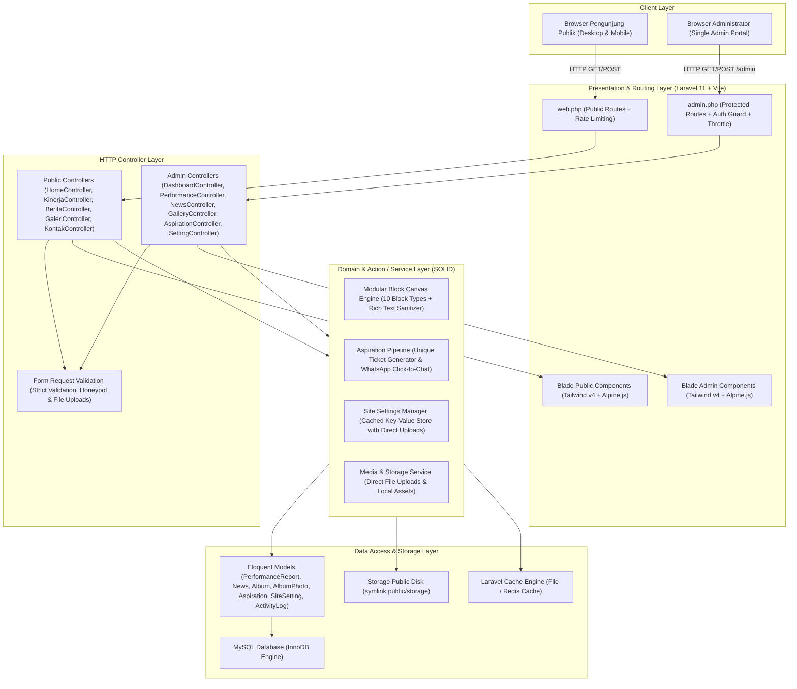
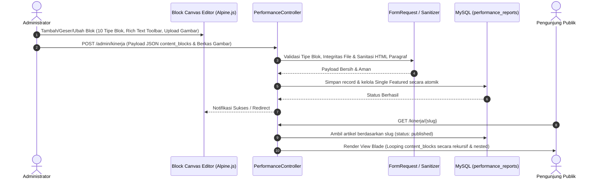
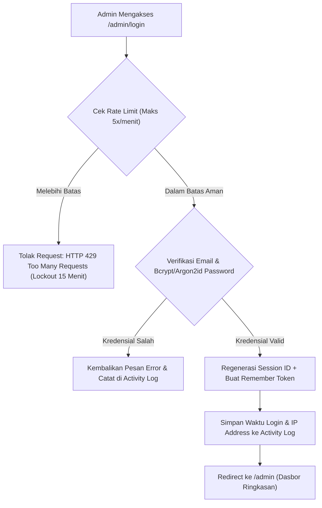
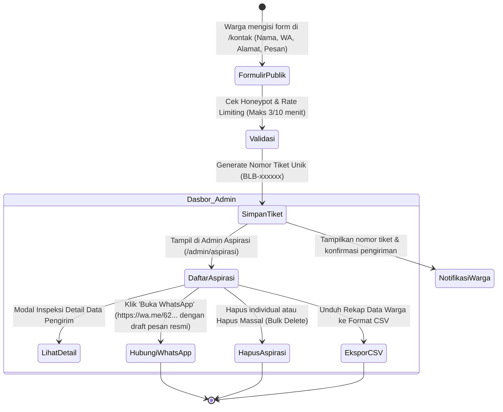

# Software Architecture & Technical Design Document
## Website Personal Profile, Hasil Kinerja, Berita & Kanal Aspirasi
### Banu Lesmana Bagaskara, S.M. — Anggota DPRD Kota Bogor

---

## 1. Ikhtisar Arsitektur Sistem

Arsitektur aplikasi dibangun di atas ekosistem **Laravel 11+** dengan pola arsitektur **Clean MVC + Action/Service Layer**. Sistem ini memisahkan secara tegas tanggung jawab antara lapisan presentasi (*Presentation Layer*), orkestrasi HTTP (*Controller Layer*), logika bisnis (*Domain / Action Layer*), serta akses basis data (*Data Access Layer*).



---

## 2. Penerapan Prinsip Rekayasa Perangkat Lunak

### 2.1 SOLID Principles
1. **Single Responsibility Principle (SRP)**:
   - Setiap *Controller* hanya bertindak sebagai pengatur lalu lintas HTTP (menerima request, memanggil action, dan mengembalikan view/redirect).
   - Seluruh logika bisnis dipusatkan pada *Action* atau *Service* tunggal:
     - Pembuatan tiket pengaduan unik berformat `BLB-xxxxxx`.
     - Logika *Single Featured* pada artikel Kinerja dan Berita (memastikan tepat satu artikel aktif secara atomik).
     - Manajemen pembaruan pengaturan situs dan pembersihan cache.

2. **Open/Closed Principle (OCP)**:
   - **Modular Block Canvas Engine** dirancang terbuka untuk penambahan blok baru (*Open for extension*), namun tertutup untuk modifikasi kode inti (*Closed for modification*).
   - Setiap tipe blok kanvas mengimplementasikan penanganan data terstandarisasi. Penambahan blok baru (seperti blok metrik, lampiran dokumen, tabel, dan callout) diintegrasikan tanpa merombak skema basis data utama.

3. **Liskov Substitution Principle (LSP)**:
   - Implementasi penyimpanan berkas (`Storage::disk('public')`) dapat saling ditukar dengan penyimpanan cloud (seperti S3) secara transparan tanpa mengubah antarmuka controller.

4. **Interface Segregation Principle (ISP)**:
   - Antarmuka controller dan form request dirancang spesifik untuk tiap domain modul (misal `UpdateSettingRequest` terpisah per seksi: Umum, Beranda, Profil, dan SEO).

5. **Dependency Inversion Principle (DIP)**:
   - Controller tidak mengikat logika ke implementasi konkret tingkat rendah, melainkan mengandalkan *Dependency Injection* Service Container Laravel.

---

### 2.2 DRY, KISS, YAGNI, & Separation of Concerns (SoC)

| Prinsip | Implementasi Teknis pada Codebase |
| :--- | :--- |
| **DRY (Don't Repeat Yourself)** | Seluruh elemen visual berulang dipecah menjadi komponen Blade atomik: sidebar admin, topbar, modal konfirmasi, penampil lightbox, dan kartu konten. |
| **KISS (Keep It Simple, Stupid)** | Desain sistem monolitik modular Laravel standar. Menggunakan server-rendered Blade yang diperkaya Alpine.js tanpa kerumitan framework SPA terpisah. |
| **YAGNI (You Ain't Gonna Need It)** | Hanya membangun fitur yang benar-benar dibutuhkan dewan dan warga. Contoh: antarmuka admin aspirasi disederhanakan secara fokus untuk inspeksi, WhatsApp langsung, dan penghapusan tanpa alur birokrasi berbelit. |
| **Separation of Concerns (SoC)** | Pemisahan tegas: File migrasi & model untuk skema data, Controller untuk HTTP, Blade untuk tampilan, dan CSS Tailwind v4 terkompilasi via Vite. |

---

## 3. Arsitektur Mesin Kanvas Blok Modular (Modular Block Canvas Engine)

Editor artikel pada modul **Hasil Kinerja** menggunakan kanvas modular (WordPress Gutenberg / Notion style) yang memungkinkan penyusunan artikel secara dinamis.

### 3.1 Struktur Data Blok (JSON Schema)
Setiap artikel kinerja menyimpan susunan bloknya dalam format JSON pada kolom `content_blocks` di tabel `performance_reports`. Sistem mendukung **10 tipe blok**:

```json
[
  {
    "id": "blk-01",
    "type": "heading",
    "order": 1,
    "data": {
      "level": "h2",
      "text": "Normalisasi Saluran Air dan Penanganan Genangan di Kebon Pedes"
    }
  },
  {
    "id": "blk-02",
    "type": "paragraph",
    "order": 2,
    "data": {
      "content": "<p>Melalui advokasi anggaran bersama <strong>Dinas PUPR Kota Bogor</strong>, pengerukan sedimen lumpur sepanjang 450 meter telah selesai dilaksanakan.</p>"
    }
  },
  {
    "id": "blk-03",
    "type": "image",
    "order": 3,
    "data": {
      "url": "storage/performance/saluran-air.jpg",
      "caption": "Kondisi fisik saluran drainase pasca pengerukan bersama warga.",
      "aspect": "16/9"
    }
  },
  {
    "id": "blk-04",
    "type": "list",
    "order": 4,
    "data": {
      "style": "bullet",
      "items": [
        "Pembersihan endapan sedimen lumpur sedalam 60 cm",
        "Pemasangan u-ditch beton pracetak bertulang",
        "Pembuatan bak kontrol pembersihan sampah berkala"
      ]
    }
  },
  {
    "id": "blk-05",
    "type": "quote",
    "order": 5,
    "data": {
      "quote": "Pengawalan pokir dan aspirasi warga bukan sekadar formalitas rapat, melainkan kehadiran langsung memastikan pengerjaan tuntas di lapangan.",
      "author": "Banu Lesmana Bagaskara, S.M."
    }
  },
  {
    "id": "blk-06",
    "type": "metric",
    "order": 6,
    "data": {
      "value": "450 Meter",
      "label": "Panjang Saluran Dinormalisasi",
      "description": "Menghubungkan drainase lingkungan RW 04 dan RW 05 langsung ke saluran primer."
    }
  },
  {
    "id": "blk-07",
    "type": "attachment",
    "order": 7,
    "data": {
      "file_name": "Laporan-Monitoring-PUPR-2026.pdf",
      "file_url": "storage/attachments/laporan-monitoring.pdf",
      "file_size": "2.4 MB",
      "description": "Dokumen Berita Acara Serah Terima pekerjaan perbaikan saluran drainase."
    }
  },
  {
    "id": "blk-08",
    "type": "table",
    "order": 8,
    "data": {
      "caption": "Tabel Rekapitulasi Titik Intervensi",
      "headers": ["Titik Lokasi", "Volume Pekerjaan", "Status"],
      "rows": [
        ["RW 04 RT 02", "150 meter", "Tuntas 100%"],
        ["RW 05 RT 01", "300 meter", "Tuntas 100%"]
      ]
    }
  },
  {
    "id": "blk-09",
    "type": "callout",
    "order": 9,
    "data": {
      "title": "Catatan Pengawasan Lapangan",
      "message": "Warga diimbau untuk tidak menutup bak kontrol secara permanen demi kemudahan pemeliharaan berkala.",
      "type": "info"
    }
  },
  {
    "id": "blk-10",
    "type": "grid",
    "order": 10,
    "data": {
      "columns": 2,
      "blocks": [
        {
          "id": "blk-nested-01",
          "type": "paragraph",
          "data": { "content": "<p><strong>Kondisi Sebelum:</strong> Aliran tersumbat sampah dan pasir.</p>" }
        },
        {
          "id": "blk-nested-02",
          "type": "paragraph",
          "data": { "content": "<p><strong>Kondisi Sesudah:</strong> Air mengalir lancar saat hujan lebat.</p>" }
        }
      ]
    }
  }
]
```

### 3.2 Diagram Alur Pemrosesan Blok (Pipeline)



---

## 4. Arsitektur Otentikasi Administrator Tunggal (Single Admin)

Sesuai spesifikasi proyek:
- Pengguna umum **tidak memiliki akun** (tidak ada halaman registrasi publik).
- Hanya ada **tepat satu akun administrator** resmi yang mengelola seluruh sistem.



---

## 5. Arsitektur Alur Pengaduan Warga (Kotak Aspirasi)

Alur penanganan pengaduan dari halaman publik hingga ditindaklanjuti secara langsung oleh tim kedewanan via WhatsApp:



---

## 6. Arsitektur Pengaturan Halaman Statis & Caching

Data dinamis pada halaman publik (narasi hero, visi-misi, 12 isu, 6 program, banner ambulance, testimoni warga, kutipan resmi) dikelola melalui modul **Pengaturan Halaman Website**.

### Pola Cache-Aside (Cache-Aside Strategy)
1. Setiap kali pengunjung mengakses halaman publik (`/` atau `/kenali`), sistem terlebih dahulu membaca dari cache aplikasi (`Cache::remember('site_settings', 86400)`).
2. Jika cache belum tersedia, sistem membaca dari tabel `site_settings` di basis data dan menyimpannya di memory cache.
3. Saat Administrator memperbarui pengaturan di `/admin/pengaturan`, sistem secara atomik memanggil pembersihan cache (`Cache::forget('site_settings')`), sehingga perubahan langsung terlihat seketika oleh publik tanpa jeda *stale cache*.
