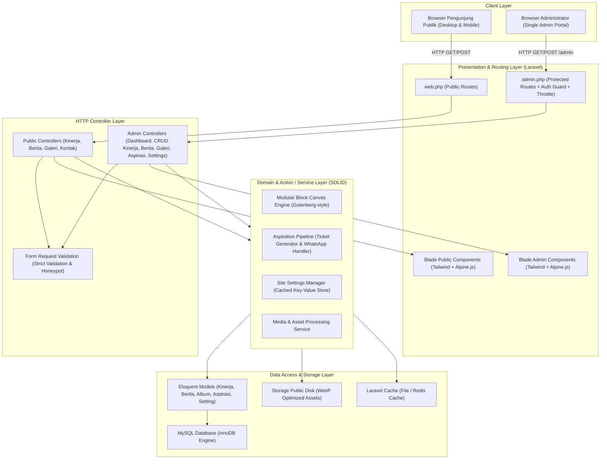
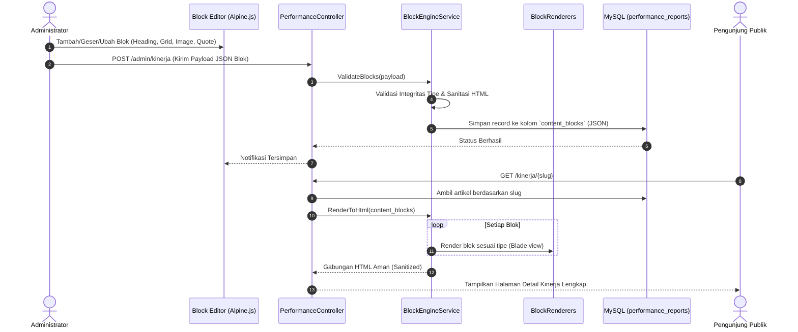
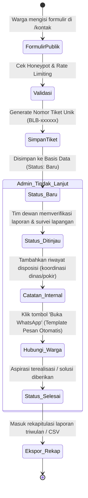

# Software Architecture & Technical Design Document
## Website Personal Profile, Hasil Kinerja, Berita & Kanal Aspirasi
### Banu Lesmana Bagaskara, S.M. — Anggota DPRD Kota Bogor

---

## 1. Ikhtisar Arsitektur Sistem

Arsitektur aplikasi dibangun di atas ekosistem **Laravel 11+** dengan pola arsitektur **Clean MVC + Action/Service Layer**. Sistem ini memisahkan secara tegas tanggung jawab antara lapisan presentasi (*Presentation Layer*), orkestrasi HTTP (*Controller Layer*), logika bisnis (*Domain / Action Layer*), serta akses basis data (*Data Access Layer*).



---

## 2. Penerapan Prinsip Rekayasa Perangkat Lunak

### 2.1 SOLID Principles
1. **Single Responsibility Principle (SRP)**:
   - Setiap *Controller* hanya bertindak sebagai pengatur lalu lintas HTTP (menerima request, memanggil action, dan mengembalikan view/redirect).
   - Seluruh logika bisnis dipindahkan ke kelas *Action* tunggal, misalnya:
     - `SubmitAspirationAction`: Memvalidasi, membuat nomor tiket `BLB-xxxxxx`, menyimpan ke database, dan menyiapkan template pesan WhatsApp.
     - `SavePerformanceReportAction`: Memproses metadata artikel dan memvalidasi struktur blok modular.
     - `UpdateSiteSettingsAction`: Memperbarui nilai pengaturan statis dan membersihkan cache aplikasi.

2. **Open/Closed Principle (OCP)**:
   - **Modular Block Canvas Engine** dirancang terbuka untuk penambahan blok baru (*Open for extension*), namun tertutup untuk modifikasi kode inti (*Closed for modification*).
   - Setiap tipe blok mengimplementasikan interface `BlockRendererInterface`:
     ```php
     namespace App\Services\BlockEngine\Contracts;

     interface BlockRendererInterface
     {
         public function supports(string $type): bool;
         public function render(array $blockData): string;
         public function validate(array $blockData): array;
     }
     ```
   - Jika di masa depan ingin menambahkan blok baru (misalnya *Video Embed* atau *Tabel Perbandingan*), pengembang cukup membuat kelas baru `VideoBlockRenderer` dan mendaftarkannya pada `BlockEngineServiceProvider` tanpa menyentuh kode blok yang sudah ada.

3. **Liskov Substitution Principle (LSP)**:
   - Seluruh implementasi kontrak penyimpanan media (`StorageServiceInterface`) dan notifikasi dapat saling menggantikan tanpa merusak fungsionalitas sistem (misalnya beralih dari `LocalStorageService` ke `S3StorageService`).

4. **Interface Segregation Principle (ISP)**:
   - Antarmuka (*interfaces*) dibuat spesifik dan ramping. Daripada membuat satu `AdminManagerInterface` raksasa, sistem membaginya menjadi `ExportableReportInterface`, `DispatchedNotificationInterface`, dan `CacheableSettingInterface`.

5. **Dependency Inversion Principle (DIP)**:
   - Controller tidak secara langsung menginstansiasi layanan menggunakan `new`, melainkan mengandalkan *Dependency Injection* melalui Service Container Laravel berdasarkan abstraksi kontrak.

---

### 2.2 DRY, KISS, YAGNI, & Separation of Concerns (SoC)

| Prinsip | Implementasi Teknis pada Codebase |
| :--- | :--- |
| **DRY (Don't Repeat Yourself)** | Seluruh elemen visual berulang dipecah menjadi komponen Blade atomik: `<x-admin.sidebar>`, `<x-admin.topbar>`, `<x-badge.status>`, `<x-form.input>`, `<x-modal.confirm-delete>`, dan `<x-lightbox>`. Tidak ada duplikasi markup HTML antarmuka. |
| **KISS (Keep It Simple, Stupid)** | Desain sistem monolitik modular Laravel standar. Menghindari kerumitan GraphQL atau microservices yang tidak diperlukan; cukup menggunakan *server-rendered Blade* yang diperkaya interaktivitas ringan *Alpine.js*. |
| **YAGNI (You Ain't Gonna Need It)** | Hanya membangun fitur yang sesuai spesifikasi 6 modul dasbor dan 6 halaman publik. Tidak menambahkan sistem multi-role, payment gateway, atau API oauth publik yang tidak dibutuhkan. |
| **Separation of Concerns (SoC)** | Pemisahan tegas: File migrasi & model untuk skema data, Action/Service untuk bisnis logika, Blade untuk antarmuka visual, dan CSS/Tailwind terkompilasi via Vite untuk styling. |

---

## 3. Arsitektur Mesin Kanvas Blok Modular (Modular Block Canvas Engine)

Salah satu fitur inti pada modul **Hasil Kinerja** adalah editor kanvas modular (bergaya WordPress Gutenberg / Notion) yang memungkinkan penyusunan artikel secara dinamis.

### 3.1 Struktur Data Blok (JSON Schema)
Setiap artikel kinerja menyimpan susunan bloknya dalam format JSON pada kolom `content_blocks` di tabel `performance_reports`:

```json
[
  {
    "id": "blk-9a8b1c",
    "type": "heading",
    "order": 1,
    "data": {
      "level": "h2",
      "text": "Normalisasi Saluran Air dan Pencegahan Genangan di Kebon Pedes"
    }
  },
  {
    "id": "blk-4d5e6f",
    "type": "paragraph",
    "order": 2,
    "data": {
      "text": "Melalui koordinasi intensif bersama Dinas PUPR Kota Bogor dan pengurus RW 05, proses pengerukan sedimen dan penggantian penutup drainase telah selesai dilakukan."
    }
  },
  {
    "id": "blk-7g8h9i",
    "type": "image",
    "order": 3,
    "data": {
      "url": "storage/performance/kebon-pedes-saluran.jpg",
      "caption": "Kondisi saluran drainase pasca pengerukan sedimen lumpur bersama warga.",
      "aspect": "16/9"
    }
  },
  {
    "id": "blk-2j3k4l",
    "type": "grid_2col",
    "order": 4,
    "data": {
      "col1": { "title": "Sebelum Intervensi", "text": "Saluran tersumbat sedimen pasir dan sampah padat, kapasitas buang air hanya 30%." },
      "col2": { "title": "Capaian Saat Ini", "text": "Aliran air normal lancar, genangan di gang permukiman surut dalam waktu kurang dari 15 menit." }
    }
  },
  {
    "id": "blk-5m6n7o",
    "type": "quote",
    "order": 5,
    "data": {
      "quote": "Pengawalan pokir dan aspirasi warga bukan sekadar formalitas rapat, melainkan kehadiran langsung memastikan pengerjaan tuntas di lapangan.",
      "author": "Banu Lesmana Bagaskara, S.M."
    }
  }
]
```

### 3.2 Diagram Alur Pemrosesan Blok (Pipeline)



---

## 4. Arsitektur Otentikasi Administrator Tunggal (Single Admin)

Sesuai spesifikasi proyek:
- Pengguna umum **tidak memiliki akun** (tidak ada halaman registrasi publik).
- Hanya ada **tepat satu akun administrator** resmi yang mengelola seluruh sistem.


---

## 5. Arsitektur Alur Pengaduan Warga (Kotak Aspirasi)

Alur penanganan pengaduan dari halaman publik hingga ditindaklanjuti oleh dewan:



---

## 6. Arsitektur Pengaturan Halaman Statis & Caching

Data dinamis pada halaman publik (narasi hero, visi-misi, 12 isu, 6 program, banner ambulance) dikelola melalui modul **Pengaturan Halaman Website**.

### Pola Cache-Aside (Cache-Aside Strategy)
1. Setiap kali pengunjung mengakses halaman publik (`/` atau `/kenali`), sistem terlebih dahulu membaca dari cache aplikasi (`Cache::remember('site_settings', 86400)`).
2. Jika cache belum tersedia, sistem membaca dari tabel `site_settings` di basis data dan menyimpannya di memory cache.
3. Saat Administrator memperbarui pengaturan di `/admin/pengaturan`, sistem secara atomik memanggil event `SettingsUpdated` yang langsung menjalankan pembersihan cache (`Cache::forget('site_settings')`), sehingga perubahan langsung terlihat seketika oleh publik tanpa jeda *stale cache*.
