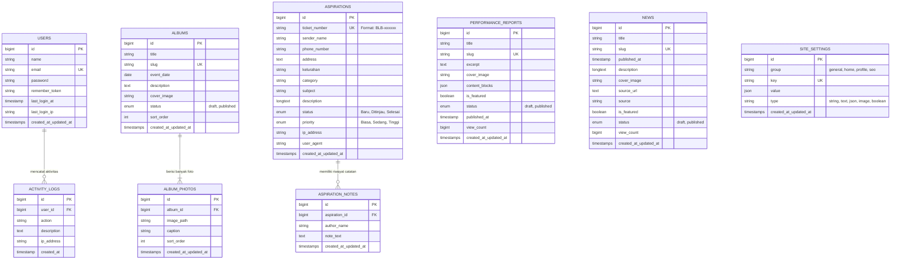

# Spesifikasi Basis Data & Skema ERD (Database Schema)
## Website Personal Profile, Hasil Kinerja, Berita & Kanal Aspirasi
### Banu Lesmana Bagaskara, S.M. — Anggota DPRD Kota Bogor

---

## 1. Diagram Hubungan Entitas (Entity-Relationship Diagram)

---

## 2. Kamus Data & Spesifikasi Tabel (Data Dictionary)

### 2.1 Tabel `users` (Akun Administrator Tunggal)
Menyimpan satu kredensial akun administrator resmi pengelola sistem.

| Nama Kolom | Tipe Data | Nullable | Keterangan |
| :--- | :--- | :---: | :--- |
| `id` | `BIGINT UNSIGNED` | Tidak | Kunci Utama (*Auto Increment*) |
| `name` | `VARCHAR(100)` | Tidak | Nama Lengkap Administrator (*default: "Administrator"*). |
| `email` | `VARCHAR(150)` | Tidak | Alamat surel login unik (*default: "admin@banubagaskara.id"*). |
| `password` | `VARCHAR(255)` | Tidak | Kata sandi terenkripsi menggunakan Bcrypt / Argon2id. |
| `remember_token`| `VARCHAR(100)` | Ya | Token persistensi login (*Remember Me*). |
| `last_login_at` | `TIMESTAMP` | Ya | Waktu terakhir kali berhasil login. |
| `last_login_ip` | `VARCHAR(45)` | Ya | Alamat IP saat login terakhir. |
| `created_at` | `TIMESTAMP` | Ya | Waktu akun dibuat. |
| `updated_at` | `TIMESTAMP` | Ya | Waktu akun diperbarui. |

*Indeks:*
- `PRIMARY KEY (id)`
- `UNIQUE KEY users_email_unique (email)`

---

### 2.2 Tabel `performance_reports` (Laporan Hasil Kinerja)
Menyimpan artikel pertanggungjawaban kinerja kedewanan beserta struktur kanvas blok modular.

| Nama Kolom | Tipe Data | Nullable | Keterangan |
| :--- | :--- | :---: | :--- |
| `id` | `BIGINT UNSIGNED` | Tidak | Kunci Utama (*Auto Increment*) |
| `title` | `VARCHAR(255)` | Tidak | Judul laporan kinerja. |
| `slug` | `VARCHAR(255)` | Tidak | URL ramah SEO yang unik (*unique slug*). |
| `excerpt` | `TEXT` | Ya | Ringkasan singkat untuk tampilan kartu di katalog. |
| `cover_image` | `VARCHAR(255)` | Ya | Path file gambar sampul utama laporan (hasil unggah berkas langsung). |
| `content_blocks`| `JSON` | Tidak | Array JSON struktur blok kanvas modular (10 blok: *heading, paragraph, image, list, quote, metric, attachment, table, callout, grid*). |
| `is_featured` | `BOOLEAN` | Tidak | Penanda laporan menjadi sorotan utama di Beranda (`default: false`). **Strictly Single Featured**: Hanya boleh tepat 1 artikel bernilai `true`. |
| `status` | `ENUM('draft','published')` | Tidak | Status publikasi (`default: 'draft'`). |
| `published_at` | `TIMESTAMP` | Ya | Tanggal & waktu laporan diterbitkan secara resmi. |
| `view_count` | `BIGINT UNSIGNED` | Tidak | Jumlah pembaca artikel (`default: 0`). |
| `created_at` | `TIMESTAMP` | Ya | Waktu pembuatan data. |
| `updated_at` | `TIMESTAMP` | Ya | Waktu pembaruan data. |

*Indeks:*
- `PRIMARY KEY (id)`
- `UNIQUE KEY performance_reports_slug_unique (slug)`
- `INDEX performance_reports_status_published_at_index (status, published_at)`
- `INDEX performance_reports_is_featured_index (is_featured)`

---

### 2.3 Tabel `news` (Berita & Rilis Pers)
Menyimpan siaran pers kegiatan dan rujukan media eksternal terpercaya.

| Nama Kolom | Tipe Data | Nullable | Keterangan |
| :--- | :--- | :---: | :--- |
| `id` | `BIGINT UNSIGNED` | Tidak | Kunci Utama (*Auto Increment*) |
| `title` | `VARCHAR(255)` | Tidak | Judul siaran pers / berita. |
| `slug` | `VARCHAR(255)` | Tidak | URL ramah SEO yang unik. |
| `published_at` | `DATE` | Tidak | Tanggal rilis berita. |
| `description` | `LONGTEXT` | Tidak | Cuplikan / ringkasan isi berita rujukan. |
| `cover_image` | `VARCHAR(255)` | Tidak | File foto sampul berita (hasil unggah berkas langsung). |
| `source_url` | `TEXT` | Ya | **Tautan / URL Sumber Rujukan Asli**: Wajib diisi pada UI form admin. Mengarahkan pembaca langsung ke artikel sumber berita asli. |
| `source` | `VARCHAR(255)` | Ya | Nama media atau rujukan sumber berita (*legacy / auto-extracted*). |
| `is_featured` | `BOOLEAN` | Tidak | Penanda berita sorotan utama di Beranda (`default: false`). **Strictly Single Featured**: Hanya boleh tepat 1 artikel bernilai `true`. |
| `status` | `ENUM('draft','published')` | Tidak | Status berita (`default: 'draft'`). |
| `view_count` | `BIGINT UNSIGNED` | Tidak | Jumlah pembaca berita (`default: 0`). |
| `created_at` | `TIMESTAMP` | Ya | Waktu pembuatan data. |
| `updated_at` | `TIMESTAMP` | Ya | Waktu pembaruan data. |

*Indeks:*
- `PRIMARY KEY (id)`
- `UNIQUE KEY news_slug_unique (slug)`
- `INDEX news_status_published_at_index (status, published_at)`

---

### 2.4 Tabel `albums` (Album Dokumentasi Kegiatan)
Mengelompokkan dokumentasi foto kegiatan warga di Dapil 4 Tanah Sareal.

| Nama Kolom | Tipe Data | Nullable | Keterangan |
| :--- | :--- | :---: | :--- |
| `id` | `BIGINT UNSIGNED` | Tidak | Kunci Utama (*Auto Increment*) |
| `title` | `VARCHAR(255)` | Tidak | Nama / Judul album kegiatan. |
| `slug` | `VARCHAR(255)` | Tidak | URL unik album. |
| `event_date` | `DATE` | Tidak | Tanggal pelaksanaan kegiatan di lapangan. |
| `description` | `TEXT` | Ya | Deskripsi rangkuman kegiatan. |
| `cover_image` | `VARCHAR(255)` | Tidak | Foto utama sampul album (hasil unggah berkas langsung atau dipilih dari foto album via "Jadikan Sampul"). |
| `status` | `ENUM('draft','published')` | Tidak | Status publikasi album (`draft`, `published`). |
| `sort_order` | `INT` | Tidak | Urutan penataan album (`default: 0`). |
| `created_at` | `TIMESTAMP` | Ya | Waktu pembuatan data. |
| `updated_at` | `TIMESTAMP` | Ya | Waktu pembaruan data. |

*Indeks:*
- `PRIMARY KEY (id)`
- `UNIQUE KEY albums_slug_unique (slug)`

---

### 2.5 Tabel `album_photos` (Foto-Foto di Dalam Album)
Menyimpan foto individu yang diunggah langsung ke dalam album induk.

| Nama Kolom | Tipe Data | Nullable | Keterangan |
| :--- | :--- | :---: | :--- |
| `id` | `BIGINT UNSIGNED` | Tidak | Kunci Utama (*Auto Increment*) |
| `album_id` | `BIGINT UNSIGNED` | Tidak | Kunci Asing merujuk ke `albums(id)` dengan `ON DELETE CASCADE`. |
| `image_path` | `VARCHAR(255)` | Tidak | Lokasi file gambar di direktori penyimpanan (*storage/albums/...*). |
| `caption` | `VARCHAR(255)` | Ya | Keterangan takarir foto saat ditampilkan di *Lightbox*. |
| `sort_order` | `INT` | Tidak | Urutan tampilan foto dalam album (`default: 0`). |
| `created_at` | `TIMESTAMP` | Ya | Waktu pembuatan data. |
| `updated_at` | `TIMESTAMP` | Ya | Waktu pembaruan data. |

*Indeks:*
- `PRIMARY KEY (id)`
- `INDEX album_photos_album_id_sort_order_index (album_id, sort_order)`

---

### 2.6 Tabel `aspirations` (Formulir Kotak Aspirasi Masuk)
Menampung pengaduan dan permohonan layanan yang disampaikan warga melalui formulir publik.

| Nama Kolom | Tipe Data | Nullable | Keterangan |
| :--- | :--- | :---: | :--- |
| `id` | `BIGINT UNSIGNED` | Tidak | Kunci Utama (*Auto Increment*) |
| `ticket_number` | `VARCHAR(30)` | Tidak | Nomor tiket unik berformat `BLB-xxxxxx`. |
| `sender_name` | `VARCHAR(100)` | Tidak | Nama lengkap warga pelapor. |
| `phone_number` | `VARCHAR(30)` | Tidak | Nomor telepon / WhatsApp aktif pelapor. |
| `address` | `TEXT` | Tidak | Alamat tempat tinggal / lokasi masalah di Bogor. |
| `kelurahan` | `VARCHAR(100)` | Ya | Nama Kelurahan (*tetap ada di skema database untuk backward compatibility*). |
| `category` | `VARCHAR(100)` | Ya | Kategori isu (*tetap ada di skema database untuk backward compatibility*). |
| `subject` | `VARCHAR(200)` | Tidak | Inti perihal permohonan / aduan. |
| `description` | `LONGTEXT` | Tidak | Uraian lengkap aspirasi yang disampaikan. |
| `status` | `ENUM('Baru','Ditinjau','Selesai')`| Tidak | Status penanganan (`default: 'Baru'`). |
| `priority` | `ENUM('Biasa','Sedang','Tinggi')`| Tidak | Prioritas urgensi (`default: 'Sedang'`). |
| `ip_address` | `VARCHAR(45)` | Ya | Alamat IP pelapor untuk audit keamanan & rate limiting. |
| `user_agent` | `TEXT` | Ya | Browser header pelapor. |
| `created_at` | `TIMESTAMP` | Ya | Waktu laporan dikirimkan. |
| `updated_at` | `TIMESTAMP` | Ya | Waktu pembaruan data. |

> [!NOTE]
> **Penyederhanaan Antarmuka Admin Aspirasi**:
> Pada antarmuka Admin (`resources/views/admin/aspirasi.blade.php`), modul aspirasi telah disederhanakan: kolom kelurahan, kategori, dan status dihilangkan dari tabel admin, kartu KPI, dan modal detail. Staf admin hanya berfokus pada 3 aksi utama: **Melihat Detail Pengaduan**, **Menghapus Aspirasi**, dan **Membuka WhatsApp Warga Langsung** (`https://wa.me/...`).

*Indeks:*
- `PRIMARY KEY (id)`
- `UNIQUE KEY aspirations_ticket_number_unique (ticket_number)`
- `INDEX aspirations_status_created_at_index (status, created_at)`
- `INDEX aspirations_kelurahan_index (kelurahan)`

---

### 2.7 Tabel `aspiration_notes` (Catatan Internal Staf Dewan)
Mencatat riwayat disposisi internal (dipertahankan pada skema basis data untuk stabilitas arsitektur).

| Nama Kolom | Tipe Data | Nullable | Keterangan |
| :--- | :--- | :---: | :--- |
| `id` | `BIGINT UNSIGNED` | Tidak | Kunci Utama (*Auto Increment*) |
| `aspiration_id` | `BIGINT UNSIGNED` | Tidak | Kunci Asing merujuk ke `aspirations(id)` dengan `ON DELETE CASCADE`. |
| `author_name` | `VARCHAR(100)` | Tidak | Nama staf / akun pencatat. |
| `note_text` | `TEXT` | Tidak | Isi catatan perkembangan atau koordinasi dinas. |
| `created_at` | `TIMESTAMP` | Ya | Waktu catatan dibuat. |
| `updated_at` | `TIMESTAMP` | Ya | Waktu catatan diperbarui. |

*Indeks:*
- `PRIMARY KEY (id)`
- `INDEX aspiration_notes_aspiration_id_index (aspiration_id)`

---

### 2.8 Tabel `site_settings` (Pengaturan Halaman Website)
Menyimpan konfigurasi statis halaman publik yang dapat diubah dari dasbor admin.

| Nama Kolom | Tipe Data | Nullable | Keterangan |
| :--- | :--- | :---: | :--- |
| `id` | `BIGINT UNSIGNED` | Tidak | Kunci Utama (*Auto Increment*) |
| `group` | `VARCHAR(50)` | Tidak | Kelompok pengaturan (`general`, `home`, `profile`, `seo`). |
| `key` | `VARCHAR(100)` | Tidak | Kunci unik (contoh: `general_logo`, `home_hero_image`, `profile_quotes`). |
| `value` | `JSON` | Ya | Nilai pengaturan (teks, URL aset, array JSON testimoni/milestones/program). |
| `type` | `VARCHAR(30)` | Tidak | Tipe data: `string`, `text`, `json`, `image`, `boolean`. |
| `created_at` | `TIMESTAMP` | Ya | Waktu dibuat. |
| `updated_at` | `TIMESTAMP` | Ya | Waktu diperbarui. |

#### Daftar Kunci Pengaturan Inti (`site_settings` keys):
- **Grup `general`**: `general_site_title`, `general_tagline`, `general_address`, `general_hotline`, `general_email`, `general_logo` (path file logo), `general_favicon` (path file icon browser), `general_socials`.
- **Grup `home`**: `home_hero_headline`, `home_hero_description`, `home_hero_image` (path file hero), `home_banner_image` (path banner ambulance), `home_collage_images` (array path foto bento), `home_testimonials` (array JSON: `name`, `role`, `content`, `avatar`).
- **Grup `profile`**: `profile_hero_image` (path file hero profil), `profile_collage_images` (array path foto profil), `profile_quotes` (JSON: `quote`, `author`, `signature_image`), `profile_milestones` (array JSON: `year`, `title`, `category`, `description`), `profile_vision`, `profile_missions`, `profile_issues`, `profile_programs` (tersinkronisasi dengan Beranda).
- **Grup `seo`**: `seo_meta_title`, `seo_meta_description`, `seo_keywords`, `seo_canonical_url`, `seo_gsc_tag`, `seo_enable_indexing`.

*Indeks:*
- `PRIMARY KEY (id)`
- `UNIQUE KEY site_settings_key_unique (key)`
- `INDEX site_settings_group_index (group)`

---

### 2.9 Tabel `activity_logs` (Log Audit Keamanan)
Merekam jejak audit keamanan seluruh perubahan data penting di dasbor admin.

| Nama Kolom | Tipe Data | Nullable | Keterangan |
| :--- | :--- | :---: | :--- |
| `id` | `BIGINT UNSIGNED` | Tidak | Kunci Utama (*Auto Increment*) |
| `user_id` | `BIGINT UNSIGNED` | Ya | Kunci Asing merujuk ke `users(id)` dengan `ON DELETE SET NULL`. |
| `action` | `VARCHAR(100)` | Tidak | Jenis aksi (misal: `LOGIN`, `UPDATE_SETTINGS`, `PUBLISH_REPORT`, `DELETE_ASPIRATION`). |
| `description` | `TEXT` | Ya | Rincian aktivitas yang dilakukan. |
| `ip_address` | `VARCHAR(45)` | Ya | Alamat IP pelaksana aksi. |
| `created_at` | `TIMESTAMP` | Ya | Waktu kejadian dicatat. |

*Indeks:*
- `PRIMARY KEY (id)`
- `INDEX activity_logs_user_id_created_at_index (user_id, created_at)`
